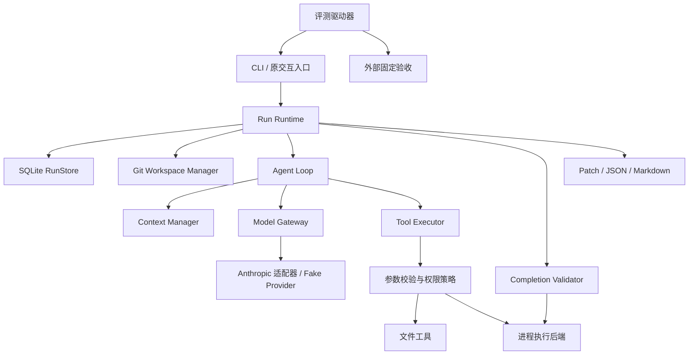

# Coding Agent Harness 项目设计与实施方案

版本：v0.1  
日期：2026-11-18  
状态：待实施设计；现有能力以第 3 节为准。本文中的新增模块、命令、配置、数据结构和验收指标均为规划，不代表已经实现。

## 1. 项目定位

基于现有 Python Agent，构建面向本地代码修改任务的执行框架：管理模型与工具的交互、运行状态、上下文、权限、资源预算、故障恢复与任务验收，并提供可复现的效果评测。

核心问题是：模型会调用工具之后，怎样让一次多步骤任务可控制、可追踪、可恢复，并知道它是否真正完成？

### 1.1 使用场景

用户指定一个本地 Git 仓库、一个已提交版本和一项修改需求。Harness 创建独立工作目录，让 Agent 阅读和修改代码、运行开发测试，并按预先确定的条件验收。结束时交付补丁、验证结果和执行报告。

示例任务：修复 Python 项目中空输入导致的异常，保留原有接口，通过指定的回归测试。

输入与输出约定：

| 输入 | 输出 |
| --- | --- |
| 仓库路径、明确的 base commit、需求文本 | 基于该 commit 的 patch 和新增文件清单 |
| 开发测试命令、固定验收配置 | 每项验收的结果、退出码、耗时与证据 |
| 模型、工具策略、上下文策略和预算 | 实际用量、失败原因、完整运行轨迹 |
| 可选的已有 run_id | 恢复记录、仍待人工处理的操作 |

首版支持受信任的本地 Python Git 项目；从固定 commit 开始，用户未提交的修改不纳入运行，也不被清理或覆盖。存在未提交修改时明确提示输入范围，由用户先形成所需 commit。

### 1.2 项目应形成的工程成果

1. 一个可运行的 Coding Agent CLI，能完成从需求到补丁和验收的闭环。
2. 一个有明确状态转换、检查点和工具恢复规则的运行时。
3. 一套覆盖模型、工具、上下文和验收的结构化追踪机制。
4. 一套固定任务集、故障注入与对照实验，能够衡量收益与成本。

简历描述必须能对应到源码、测试、演示或实验数据；对教程的复用和个人新增设计分别说明。

## 2. 范围与优先级

### 2.1 核心交付范围

- CLI 执行代码修改任务；单个 run 同时只有一个执行者。
- 按 run 隔离配置、对话、工作目录、预算、工具状态和结果。
- 持久化模型与工具边界，支持进程中断后的续跑。
- 工具参数校验、权限决策、超时、输出限制与取消。
- 基于固定验收条件的完成判定。
- 结构化事件、补丁和 Markdown/JSON 报告。
- 离线确定性测试、小规模真实模型评测及故障注入。

### 2.2 现有扩展能力的处理

技能、记忆、定时任务、子代理、团队和工作流保留。核心基准默认关闭跨任务记忆、定时任务和团队，避免额外变量影响可复现性。逐个接入统一 RunContext、模型网关和工具执行器后，再声明这些能力具备相同的预算、追踪和恢复保证。

现有 MCP 是模拟工具发现与调用。真实 MCP 协议适配可以作为后续扩展，不计入首版完成条件。

### 2.3 后续扩展

- Linux 容器执行后端，处理更强的文件、网络、资源隔离需求。
- 子代理共享预算及父子调用追踪。
- 多 run 并行调度和真实 MCP 适配。
- 只读运行轨迹页面。

首版聚焦本地 CLI 和执行可靠性；账号、登录、云服务、多租户、计费、自动 PR 发布以及前端管理系统均暂缓。

## 3. 当前代码基础与差距

以下是源码静态阅读结论，尚未执行功能验收。

| 模块 | 已有基础 | 本方案需要补齐的部分 |
| --- | --- | --- |
| `main.py` | 交互与单次输入，交付定时、后台与队友消息 | 引入独立 run 生命周期；当前主 history 主要位于内存 |
| `agent/loop.py` | 模型/工具循环，压缩，截断续写，目标续轮 | 提取明确步骤边界，注入运行依赖，持久化状态与结束原因 |
| `agent/client.py` | 限流/过载重试、备用模型 | 统一各类模型调用的用量、尝试记录、超时和预算 |
| `agent/tools/registry.py` | 基础与扩展工具登记 | 工具描述与执行器共享参数约束、权限和恢复元数据 |
| `agent/tools/executor.py` | Hooks、工具分发、异常转文本 | 结构化 ToolResult，执行意图记录，失败分类和恢复决策 |
| `agent/tools/files.py` | 文件读写、替换、glob | 写前/写后摘要、原子替换、冲突识别和范围保护 |
| `agent/tools/shell.py` | 120 秒超时、输出截断、退出清理 | 流式限制输出内存；按 run 管理进程；验证 Windows 子进程树清理 |
| `agent/background.py` | 后台线程、内存任务表、一次性通知 | 持久化启动/完成/交付状态；中断后识别结果不明的任务 |
| `agent/permissions.py` | 文件路径检查、Shell 确认、模拟 MCP 策略 | 明确策略对象；权限检查独立于可选 Hooks；工作目录与执行隔离分层 |
| `agent/context.py` | 工具结果归档、主动/补救压缩 | 可配置策略、上下文版本、保留约束和质量评测 |
| `agent/goals.py` | 独立模型判断器、续轮限制 | 增加确定性验收；统一判断器用量；避免只凭模型宣布成功 |
| `agent/workflow_runtime.py`、`workflows.py` | 工作流快照、journal、文件锁和局部预算 | 复用设计经验；当前工作流恢复不等于主 Agent 或任意工具副作用恢复 |
| `agent/worktrees.py` | 按 task 创建并校验 worktree | 新增按 run 创建与校验的入口，不要求先创建协作任务 |
| `check_*.py` | 若干手工验收脚本 | 将关键行为补为无需 API key 的自动断言和故障测试 |

## 4. 总体架构



### 4.1 组件职责

- **RunRuntime**：驱动生命周期，检查控制请求与预算，在模型/工具边界提交状态，协调恢复。
- **AgentLoop**：解释模型输出，提出工具调用或结束意图。返回结构化结果，由 Runtime 决定是否验收、续轮或停止。
- **ModelGateway**：封装模型调用、消息序列化、重试、模型切换、用量和超时；不执行工具。
- **ToolExecutor**：实施参数、权限、预算、执行记录和结果落盘；成功与失败都有类型化结果。
- **RunStore**：持久化运行事实、事件和检查点，校验状态转换及唯一约束。
- **CompletionValidator**：根据冻结配置执行验收，输出证据和判定；检查不通过时返回有限的反馈。
- **WorkspaceManager**：固定 commit、创建独立 worktree、校验恢复指纹、生成补丁与新增文件清单。
- **Evaluator**：创建干净任务环境，执行配置对照、故障注入和最终独立验收。

### 4.2 RunContext 与依赖注入

RunContext 至少包含：`run_id`、冻结配置、workspace、store、model_gateway、tool_executor、budget、context_manager、validator、cancellation_token。

新路径不从全局单例读取本次任务状态。首先接入单主代理，保留旧模块适配层，逐步迁移。Fake Provider、临时 Store 和可控时钟可以替换真实实现；导入类型与存储模块不应要求 API key 或 MODEL_ID。

Hook 用于扩展和观察。权限、预算、持久化等核心约束必须由固定执行路径实施，不能因某个 Hook 提前返回而被跳过。

## 5. 运行状态与生命周期

### 5.1 状态定义

| 状态 | 含义 | 后续操作 |
| --- | --- | --- |
| `created` | 配置、版本及工作目录已登记 | 启动 |
| `running` | 执行模型或工具步骤 | 继续、等待、验收或停止 |
| `waiting` | 等待本 run 的已登记后台任务 | 收到完成事件后继续 |
| `verifying` | 执行固定完成条件 | 通过、反馈续轮或结束 |
| `needs_attention` | 权限待确认、操作结果不明、环境有冲突 | 明确处理后恢复，或取消 |
| `interrupted` | 旧执行者已退出，本次运行尚未形成终态 | 恢复或取消 |
| `completed` | 固定验收通过且不存在未解决的工具操作 | 只读查看 |
| `failed` | 不可恢复错误，或已达到验证失败次数上限 | 只读查看 |
| `cancelled` | 已停止本 run 的可管理执行，取消完成 | 只读查看 |
| `exhausted` | 达到预算，已停止执行并保存部分结果 | 只读查看 |

允许的转换：

```text
created -> running
running -> waiting | verifying | needs_attention | interrupted | failed | exhausted
waiting -> running | needs_attention | interrupted | failed | exhausted
verifying -> completed | running | needs_attention | interrupted | failed | exhausted
needs_attention -> running | interrupted
interrupted -> running | needs_attention
created/running/waiting/verifying/needs_attention/interrupted -> cancelled
```

`cancelled` 转换仅在清理成功后提交；清理结果不明则进入 `needs_attention`。`completed/failed/cancelled/exhausted` 为不可继续执行的终态；需要新预算或新配置时创建新 run，并记录 `parent_run_id`。未清理的后台进程不允许直接形成正常终态。

### 5.2 正常执行顺序

1. 校验配置，解析 base ref 为不可变 commit，创建工作目录，冻结配置指纹。
2. 记录用户任务和初始检查点，进入 `running`。
3. 每个模型请求前检查取消、预算与上下文；登记 attempt 后调用模型。
4. 将完整模型响应与待执行工具列表持久化，再逐个执行工具。
5. 每个工具完成后，事务内保存结果及对应工具消息，推进检查点。
6. 模型请求结束时进入 `verifying`；必要后台任务未完成则先等待。
7. 固定验收通过后生成 patch 与报告，提交 `completed`。不通过时在预算和验证次数内返回反馈，继续执行。
8. 无法通过时保存部分产物，明确区分验证失败、基础设施失败、取消和预算耗尽。

同一批多个工具调用也逐个持久化；恢复时能识别已完成的调用，不重新执行整批。检查点允许存在尚未返回结果的工具请求，恢复后先补齐该批结果，再发下一次模型请求。

## 6. 存储、事件与一致性

### 6.1 存储选择

采用 Python 标准库 SQLite 保存运行状态与事件，文件系统保存较大的工具输出和补丁。先建立最小迁移机制，不新增 ORM。

SQLite 是运行事实的权威来源；JSONL、JSON 和 Markdown 是查询导出的产物，不能成为另一套可独立修改的运行状态。已有 `.tasks`、`.memory`、`.mailboxes` 的迁移不放在首版范围内。

建议目录：

```text
.runtime/harness/
  state.sqlite3
  locks/<run_id>.lock
  runs/<run_id>/artifacts/
  runs/<run_id>/exports/
.worktrees/harness/<run_id>/
```

运行元数据位于工作目录之外；专用文件工具只允许访问本 run 工作目录。受信任本地 Shell 仍有宿主用户权限，不能据此声称元数据或秘密对任意命令不可访问。

### 6.2 最小数据模型

| 表 | 关键字段与约束 |
| --- | --- |
| `runs` | id、parent_run_id、status、reason_code、base_commit、workspace、config_json、config_hash、schema_version、created_at、updated_at |
| `messages` | run_id、message_seq、role、规范化 content_json；唯一 `(run_id, message_seq)` |
| `model_attempts` | id、run_id、logical_step_id、attempt_no、purpose、model、request_hash、status、usage_json、duration_ms、error_code；同一步 attempt_no 唯一 |
| `tool_calls` | id、run_id、provider_tool_use_id、response_id、tool_name、args_json、args_hash、recovery_class、status、result_json、artifact_ref；逻辑调用 ID 唯一 |
| `checkpoints` | run_id、checkpoint_seq、event_seq、message_seq、context_version、pending_calls、累计预算、状态；版本校验 |
| `events` | run_id、seq、event_type、step_id、parent_step_id、timestamp、payload_json；唯一 `(run_id, seq)` |
| `control_requests` | id、run_id、type、payload_json、created_at、handled_at；用于取消及人工解决请求 |
| `validations` | id、run_id、validator_id、workspace_digest、status、exit_code、artifact_ref、duration_ms |

启动连接启用外键、设置 busy timeout；数据库迁移有 schema version。数据库写事务只覆盖状态更新，不跨模型网络请求或工具执行长期持锁。

### 6.3 提交规则

- 每次运行由一个文件锁保护执行者所有权；同一 run 的第二个执行者立即失败。复用并测试现有文件锁的跨平台行为。
- 工具执行前，先提交 `started` 意图。外部动作完成后，在同一事务内保存工具结果、对应消息、事件和检查点。
- 大输出先写临时文件，完成刷新并原子替换为正式文件，再提交引用及内容摘要。事务失败产生的无引用文件可回收；引用缺失或摘要不匹配时禁止直接恢复。
- SQLite 事务保证库内一致性，不能与任意外部工具动作组成一个原子事务。两者之间的窗口按第 7 节处理。
- 导出文件中断可以重新生成；不影响已提交的执行状态。
- 主进程异常退出后，查询命令可显示疑似失联。只有获得执行锁、核对旧执行者已不再运行后，才能标记 `interrupted`，不能仅凭心跳过期接管。
- 外部取消命令只写入 control request，由当前执行者处理；不绕过运行状态机并发修改工具结果。

## 7. 中断恢复与工具副作用

### 7.1 恢复的保证边界

保证持久化的模型响应和工具结果可以复用；对结果不明的操作采取明确策略。首版不承诺任意 Shell 命令 exactly-once，也不恢复已经丢失的 Python 线程或 SDK 网络连接。

`resume` 必须检查 schema、冻结配置、工具实现版本、base commit、workspace 路径及文件摘要。恢复时使用原配置；配置或源码不兼容需要明确迁移或创建新 run。人工修改工作目录造成的冲突进入 `needs_attention`。

### 7.2 按恢复类别处理

| 类别 | 示例 | started 后未记录结果的处理 |
| --- | --- | --- |
| `read_only` | 文件读取、glob | 在工作目录指纹核对后重试，并记录新 attempt |
| `reconcilable` | 有写前/写后内容摘要的文件写入和替换 | 当前内容为写后摘要则核实已完成；为写前摘要则重试；其他内容视为冲突 |
| `non_replayable` | 通用 Shell、有外部影响的调用 | 标为 `unknown`，进入 `needs_attention`；不自动重放 |

工具恢复类别由宿主注册信息决定，不能只根据模型参数或 MCP 服务自述决定。禁止凭命令名称将任意 Shell 判定为幂等。

文件工具需要保存明确目标内容及写前/写后摘要；编辑采用“校验旧内容 → 临时文件 → 原子替换”。普通进程崩溃后可以核对内容；断电、磁盘损坏和外部同时写入按失败或冲突报告，不承诺全自动修复。

### 7.3 关键崩溃窗口

| 中断位置 | 恢复行为 |
| --- | --- |
| 模型请求发出前 | 使用相同逻辑步骤、新 attempt 发起调用 |
| 模型服务可能已返回，但响应未持久化 | 标记该 attempt 结果未知；允许重新请求，记录可能重复计费 |
| 模型响应已持久化，工具尚未执行 | 使用已存响应继续，不重复调用模型 |
| 某个工具执行后，结果尚未提交 | 根据恢复类别重试、核对或要求人工处理 |
| 工具结果已提交，下一轮尚未开始 | 从已提交消息继续，不重复执行该工具 |
| 上下文压缩结果未提交 | 继续使用旧上下文版本，不使用半份摘要 |
| 后台命令已启动，进程中断 | 核对进程身份与完成产物；无法确认时标记 unknown，禁止自动重启 |

人工处理通过 `resolve` 明确选择：附证据确认结果、授权重试或取消。处理动作写入事件；授权重试会创建新 attempt，原记录保留。拒绝或跳过工具应形成失败工具结果，不能伪造为成功。

后台任务的“完成事实”和“结果进入对话”分开保存；唯一事件 ID 与已消费标记在加入消息的同一事务提交，防止恢复后重复注入。

## 8. 工具执行、进程与权限

### 8.1 结构化接口

新增 ToolSpec 与 ToolResult，现有字符串处理函数通过适配器逐步接入。

```text
ToolSpec:
  name, input_schema, permission_class, recovery_class, timeout_seconds

ToolResult:
  status: ok | error | denied | timeout | cancelled | unknown
  output_preview, artifact_ref, exit_code, error_code, retryable, duration_ms
```

执行顺序固定为：参数校验 → 路径与权限检查 → 预算检查 → 提交执行意图 → 执行 → 保存结果。向模型返回的工具消息由结构化结果生成，错误设置对应错误标记，不能仅靠字符串前缀区分成功失败。

### 8.2 权限策略

- 文件工具限定 run workspace，解析真实路径并处理符号链接、Windows junction 和越界路径；禁止模型通过文件工具写宿主配置、运行数据库或原始仓库。
- 授权依据包括工具名、参数摘要、工作目录和当前策略版本；参数变化后旧授权失效。
- 非交互运行遇到需确认的操作进入 `needs_attention`，不在后台线程直接读取终端。
- Shell 默认要求授权；评测受信任 fixture 使用固定策略。验收命令从宿主冻结配置读取，不由模型临时替换。
- 日志不记录 API key 和完整环境变量。受保护内容默认不提供给文件工具；错误和参数预览进行脱敏。原始轨迹仅本地保存、显式导出，不能声称字符串脱敏能消除全部敏感内容。

路径校验、命令授权与 worktree 分别解决访问范围、执行决策和修改隔离。通用 Shell 在本地后端具备用户权限；命令黑名单是辅助规则，不作为安全沙箱。

### 8.3 进程生命周期

- ProcessBackend 按 run 登记句柄、启动标识、退出状态和输出产物；PID 本身不足以确认进程身份，避免误杀被复用的 PID。
- 输出按块写产物并限制总字节数，预览单独截断；不能先无限缓存再截断字符串。
- POSIX 后端使用独立进程组；Windows 后端优先使用可管理子进程树的 Job Object，需有真实父子进程测试。
- 原型后端可以先支持受限的同步命令；未实现进程树管理的平台不得宣称完整后台任务取消保证。
- 超时、取消后先停止本 run 的进程树，再保存退出结果；清理失败进入 `needs_attention`，报告遗留资源。
- 强制终止与普通退出分开测试。依赖 `atexit` 不能作为崩溃清理保证。
- CLI cancel 由 Runtime 定期处理；模型请求具有明确超时，工具循环和重试等待可响应取消。无法立即终止的远端请求要如实记录，在返回或超时前保持取消处理中。

## 9. 模型网关与预算

### 9.1 统一调用路径

主代理、压缩、模型验收、记忆提取及后续子代理均逐步接入同一 ModelGateway。记录 purpose、模型、请求指纹、attempt、耗时、stop reason 和 SDK 返回的用量。

适配器提供规范化响应，使用显式 JSON 序列化；不依赖 `str(SDK对象)` 恢复对话。Fake Provider 可返回文本、工具调用、截断、异常和无效结构化结果，用于离线测试。

保留当前限流/过载恢复思路，但只有网关的一层管理重试；关闭或显式协调 SDK 隐式重试，避免次数与预算失真。模型切换写事件，评测中默认禁用或所有对照使用相同策略。

### 9.2 预算项目

| 限制 | 计量与处理 |
| --- | --- |
| 模型请求次数 | 每次网络 attempt 计数，包含重试、压缩与判断器 |
| 工具次数 | 每个实际执行 attempt 计数；已存结果复用另记命中数 |
| 活跃执行时间 | 累加各执行段时间；恢复后不清零；人工等待时间单独展示 |
| token | 累计 SDK 报告用量，区分输入、输出及供应商返回的缓存字段 |
| 验证轮数 | 每轮固定验收计数，防止无限“失败—修改”循环 |
| 输出与产物大小 | 限制单工具及单 run 体积，触发限制时保留截断原因 |

请求前估算输入并预留最大输出，约束新的调用；响应后结算。token 是供应商报告值和估算共同管理的资源，不能保证网络结果不明时的精确账单硬上限。结果未知保留预留量或保守估算，报告 `usage_incomplete`；不得按零消耗恢复预算。

重启复用已累计预算；模型判断、摘要等辅助调用也计入。首版不承诺精确货币成本；如增加成本估算，必须随报告保存计价配置与日期。

## 10. 上下文与完成验收

### 10.1 上下文策略

提供 `full_until_limit`、`truncate_tools`、`summary` 三种可配置策略，用于后续对照。

- 始终保留当前需求、固定约束、未完成步骤以及工具调用/结果配对。
- 大工具输出以摘要和产物引用呈现，允许按范围重新读取。
- 压缩得到新 context_version，记录压缩前后规模、策略、摘要模型和用量。
- 原始消息是不可变历史；发送给模型的压缩上下文是可版本化视图。
- 压缩失败保留旧版本；超出模型可用范围则明确停止或有限补救，不能静默丢弃关键工具结果。
- 评测关闭跨任务记忆，技能集合和提示词版本固定，防止任务间信息泄漏。

### 10.2 完成条件

任务开始时冻结 validator 配置和预期结果，至少支持：

| Validator | 行为 |
| --- | --- |
| `command_exit` | 执行固定 argv，记录退出码和日志 |
| `file_assertion` | 检查指定文件、内容或结构 |
| `artifact_assertion` | 检查补丁、产物及变更范围 |
| `llm_judge` | 语义判断的辅助证据，不能覆盖确定性失败 |

各项返回 `pass/fail/error`；命令无法启动或超时属于 error，不能当作通过。所有必选确定性检查通过、工作目录版本匹配且无未解决工具操作，才允许 `completed`。

测试结果绑定 workspace digest；测试之后又修改文件则结果失效，需要重验。测试通过只表示配置条件通过，不表示任意需求均被完全证明。

开发测试位于工作目录，可以向 Agent 展示。基准最终验收由外部评测器控制，检查定义不受 Agent 修改；在干净检出上应用补丁并执行固定验收，避免“修改测试使其通过”。本地受信任后端不提供对恶意 Agent 的防篡改保证；需要该保证时使用隔离执行后端。

## 11. CLI 与交付产物

以下命令均为拟实现接口；现有 `python main.py` 继续保留。

```powershell
# 从固定版本开始一次任务；run 命令前台执行
python -m agent.cli run --repo C:\repos\sample --base <commit> --task-file task.md --config configs\coding-local.yaml

python -m agent.cli status <run_id>
python -m agent.cli events <run_id>
python -m agent.cli resume <run_id>
python -m agent.cli cancel <run_id>
python -m agent.cli resolve <run_id> --call <call_id> --action retry
python -m agent.cli report <run_id> --format markdown

python -m agent.cli eval --suite evals\suites\core.yaml --config configs\eval-baseline.yaml
```

`resolve --action retry` 是用户对特定不明操作的再次执行授权，不自动确认原操作未发生；CLI 展示原参数及风险，确认动作记录在轨迹中。

拟定配置：

```yaml
schema_version: 1
model:
  provider: anthropic
  id_env: MODEL_ID
  request_timeout_seconds: 60
  max_attempts_per_step: 3
budget:
  max_model_attempts: 40
  max_tool_attempts: 80
  max_active_seconds: 1200
  max_reported_and_reserved_tokens: 100000
  max_validation_rounds: 3
context:
  strategy: summary
execution:
  backend: local
  policy: confirm_shell
validators:
  - id: regression
    type: command_exit
    argv: [python, -m, unittest, discover, -s, tests]
    expected_exit_code: 0
    timeout_seconds: 120
```

配置数值是示例，后续根据实测调整。密钥只从环境读取，不保存到冻结配置；运行开始时解析并冻结模型 ID、配置值与工具版本。

报告至少包含：任务、base commit、配置指纹、终态和原因、变更文件、补丁、每项验收、耗时与用量、模型切换和重试、压缩记录、中断与恢复记录、结果未知的操作及限制。

补丁必须包含新增文件；报告同时记录未跟踪文件、二进制文件和不支持导出的修改。无法完整导出时不能报告“交付成功”。评测时在干净 base 上应用补丁，以实际应用结果验收。

## 12. 可复现评测设计

### 12.1 两类测试分开

**运行时确定性测试**使用 Fake Provider、临时 Git fixture 和可控故障，不需要密钥。用于验证协议、持久化、预算、状态及恢复规则。

**真实模型任务评测**用于衡量实际完成率和资源消耗。首轮先做 5 个任务验证评测流程，再扩展到 24 个固定任务；每种配置每任务重复至少 3 次，并按预算决定是否扩大。

建议任务分布：8 个局部缺陷修复、8 个多文件修改、8 个需要较长阅读和工具反馈的任务。为其中 8 个任务建立额外故障注入版本，分别汇报正常与故障组，不混为一个总成功率。

任务清单固定：任务 ID、初始 commit、需求、允许变更范围、开发测试、外部验收、超时、环境版本、依赖来源与许可。任务来源、人工编写过程和验收局限要记录。

### 12.2 对照实验

| 实验 | 对照设置 | 主要问题 |
| --- | --- | --- |
| 完成验收 | 模型自行结束 / 固定验收反馈续轮 | 是否减少过早结束，付出多少用量与延迟？ |
| 上下文策略 | full_until_limit / truncate_tools / summary | 成功率、超限率和 token 如何变化？ |
| 故障恢复 | 从头重跑 / 检查点恢复 | 已完成步骤复用多少，是否发生非预期重复执行？ |

各实验只改变目标因素，保持任务、模型、工具集合、提示词版本和安全约束一致。外部验收器对所有配置相同，独立于运行时是否宣布完成。

固定总预算下的比较计入压缩与判断器用量，体现真实资源取舍；如额外展示不限制 token 的诊断实验，单独标注。基线达到上下文上限属于可观察结果，不能将其静默排除。

交错运行不同配置以减小服务时段影响；记录完整请求时间和实际模型 ID。托管模型不能保证完全确定性，报告重复次数、逐任务结果和波动，不夸大单次差异。

### 12.3 指标口径

- **外部任务成功率**：外部固定验收通过次数 / 全部计划且已执行的试验次数。基础设施错误计入端到端失败，并另外分类。
- **过早结束率**：自行宣告完成但外部验收失败的次数 / 自行宣告完成次数；分母为零时记 N/A。
- **故障恢复成功率**：注入故障后完成外部验收的次数 / 有效注入次数；同步报告从头重跑基线。
- **非预期重复执行数**：已提交完成或不允许自动重放的逻辑工具调用被再次实际执行的次数。预期只读重试另计。
- **资源消耗**：每任务的模型 attempts、输入/输出及缓存用量、活跃时长、端到端时长；成功与失败均计入。
- **步骤复用率**：恢复时直接复用的已完成步骤 / 故障前已完成步骤；不存在可复用步骤时记 N/A。

同时报告总 token / 成功任务数，分子包含失败运行成本；无成功任务时记 N/A。对比时展示逐任务配对结果、均值/中位数与重复运行波动；样本足够时再给置信区间，不以最高分代替汇总结果。

故障注入必须记录准确步骤和注入事件。强制结束 Harness 的测试与 Fake Provider 抛异常的测试分别报告，后者不能替代真实进程中断实验。

## 13. 测试与验收清单

| 场景 | 确定性验收要求 |
| --- | --- |
| 单工具与同批多工具 | 工具 ID 配对正确；部分完成后恢复不重放已提交调用 |
| 文件操作后崩溃 | 写前、写后、外部冲突三种内容分别对应重试、确认、人工处理 |
| 不明 Shell 副作用 | 使用递增计数 fixture，恢复不自动增加第二次 |
| 中断恢复 | 子进程强制退出后，已提交模型响应和工具结果可复用 |
| 重复恢复 | 第二执行者无法获得运行锁；不因心跳慢而错误接管 |
| 后台结果交付 | 完成事件重复出现或恢复后，模型对话只注入一次 |
| 预算 | 模型重试、摘要、判断器均计入，重启不重置 |
| 取消与超时 | 父子进程、长输出、等待模型请求均有明确结果；无误杀无关进程 |
| 权限 | 越界、符号链接/junction、参数变化、后台授权均按策略处理 |
| 验收 | 修改测试不能改变外部验收；验收后再改文件导致结果失效 |
| 压缩 | 调用/结果配对完整；摘要失败使用旧版本；恢复读取正确 context_version |
| 存储 | 工具完成事务回滚、产物缺失、内容摘要损坏均不会静默继续 |
| 配置与版本 | 配置、工具版本或 base 冲突时拒绝静默恢复 |
| 离线运行 | 无 API key 可以导入并运行 Fake Provider 全套测试 |

建议使用 pytest 组织上述测试，并将受支持平台加入 CI。Windows 特有进程、路径测试必须在 Windows 实际执行；未测试平台在支持矩阵中标注。

这里的测试针对故障边界、状态约束与产物正确性，不以 mock 调用次数或机械覆盖每行代码为目标。

## 14. 实施里程碑

### M1：任务闭环与最小追踪

改动范围：新增 RunContext、CLI、最小 RunStore、ModelGateway 适配器与结构化结果；复用主循环、工具及 worktree；增加固定验收与报告。

交付：一个本地缺陷修复 demo、Fake Provider demo、patch、报告和事件导出；API 密钥缺失时离线 demo 可运行。

验收：同一任务能从干净 commit 运行到补丁交付；外部应用补丁后通过固定测试；失败时能够解释结束原因。此阶段尚不宣称支持崩溃恢复。

### M2：持久化与恢复

改动范围：消息、工具意图、结果和检查点的事务边界；模型响应复用；文件核对恢复；unknown 操作处理；版本与工作目录校验。

交付：可指定步骤中断的 demo、resume/resolve 命令、崩溃窗口测试。

验收：同批工具部分执行、文件写入未记结果、Shell 结果不明三类场景均按规则处理；第二执行者不能并发恢复；预算继承正确。

### M3：执行控制与上下文

改动范围：统一预算、超时与取消、进程树管理、后台任务持久化、上下文版本和三种策略。

交付：资源限制与取消演示、支持矩阵、Windows/POSIX 对应进程测试、压缩策略对照入口。

验收：受支持后端的父子进程可清理；大输出不造成无界缓存；上下文压缩失败与恢复不破坏消息协议；辅助模型调用全部计量。

### M4：评测与作品交付

改动范围：固定任务集、独立验收驱动器、三组对照、故障注入、CI、README 和架构说明。

交付：版本化评测清单、原始结果、汇总脚本、实验报告、3～5 分钟演示流程。

验收：可用固定配置重新执行一组实验；每个公开数字能够追溯到原始运行；失败和结果未知的运行保留在统计中；明确个人新增实现与教程基础。

按 M1 → M2 → M3 → M4 顺序推进。先完成一个真实任务，再扩大评测集；每个阶段独立可演示，避免一次性重写所有模块。

## 15. 建议目录与迁移方式

```text
agent/
  cli.py                      # 新 CLI，原 main.py 保留
  runtime/
    types.py                  # RunContext、状态与结果类型
    runner.py                 # 生命周期与检查点边界
    store.py                  # SQLite、事务与迁移
    recovery.py               # 核对与恢复决策
    budget.py                 # 请求预留与结算
    gateway.py                # Anthropic / Fake Provider
    process.py                # 按 run 管理进程的后端接口
    validation.py             # 固定验收
    reporting.py              # 事件、补丁和报告
  loop.py                     # 逐步接入运行依赖
  tools/                      # 现有工具经适配器接入
configs/
tests/
  unit/
  integration/
  fixtures/
evals/
  tasks/
  suites/
  runner.py
  summarize.py
docs/
  harness-design.md
  experiments.md              # 有真实实验后再创建
```

目录是职责建议，实施时按实际规模拆分。复用 `agent/filelocks.py` 等基础代码；不为了目录形式复制一套业务逻辑。现有工作流 journal 与新 RunStore 的边界先保持独立，接入时显式定义父子 run 与预算，不把两种日志混为同一恢复协议。

## 16. 展示与简历证据

推荐演示顺序：正常修复 → 查看运行轨迹 → 指定步骤中断并恢复 → 结果不明的工具停下来等待处理 → 查看同一任务集的配置对照。

简历描述模板，待实现和实测后填写：

> 基于 Python 构建面向代码修改的 Agent Harness，统一模型调用、工具调度、固定验收与运行追踪；设计基于事务检查点和副作用分类的恢复机制，支持中断续跑、预算控制及进程取消。构建 N 项固定任务及故障注入评测，在相同模型和预算下比较验收反馈、上下文策略与恢复机制的效果，记录成功率、资源消耗和重复执行情况。

可讨论的技术取舍：外部工具副作用与数据库事务的边界、恢复而不盲目重放、确定性验收与语义判断的配合、压缩节省与信息损失、Windows 进程树控制，以及评测中的公平比较和失败归因。

只有完成对应模块和验证后，才能把这些能力写成“已实现”；所有收益数字来自保存的实验结果。
